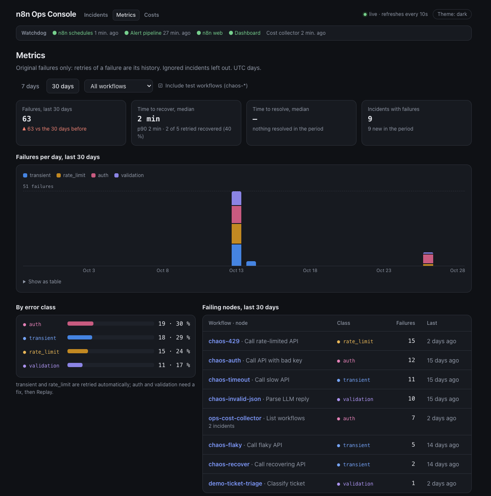
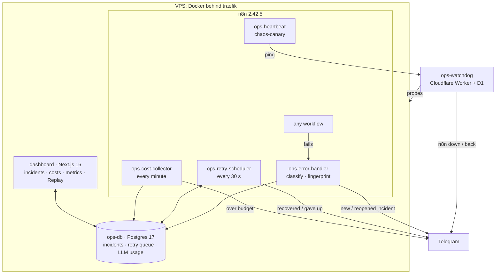

# n8n Ops Console

[](https://github.com/andriisap/n8n-ops-console/actions/workflows/ci.yml)

A reliability layer for self-hosted n8n. Every failed workflow becomes an incident with a class and a fingerprint, transient failures are retried with backoff, every LLM call is priced, a watchdog outside the server checks that n8n and the alert path are alive, and a Next.js dashboard shows all of it.

Built as a portfolio project by a React/Next.js developer moving into AI automation. It runs on a real n8n 2.42.5 instance, and every failure mode in the table below was broken on purpose and watched.



## Problem

An n8n workflow that fails at 3 a.m. writes a red line into the execution list and nothing else. Nobody is told, the same 429 fails a hundred times in a row, a run that would have worked ten seconds later is never retried, and an LLM workflow's bill shows up at the end of the month without saying which workflow spent it. If n8n itself stops, no error workflow runs at all.

What this project adds on top of a stock n8n:

| Question | Answer here |
| --- | --- |
| Did something fail, and is it new? | One error workflow for every workflow: incident per fingerprint, one Telegram alert per new or reopened incident |
| Will it fix itself? | `rate_limit` and `transient` are retried with backoff (5 attempts, about 8 minutes); `auth` and `validation` wait for a person and a Replay button |
| What did that run cost? | Tokens of every model call from n8n's own execution data, priced by the date and the prompt-length tier; a daily budget alert |
| Is n8n even running? | A Cloudflare Worker outside the server: heartbeat, a canary that exercises the alert path every hour, HTTP probes |
| How are we doing over time? | Time to recover, time to resolve, failures per day by class, the nodes that fail most |

## Architecture



The same flow as text:

```
any workflow fails
  → ops-error-handler (Error Trigger)
  → normalize + classify (rate_limit / transient / auth / validation / unknown)
  → upsert incident by fingerprint, insert event by execution id
  → new or reopened? → Telegram alert → mark alerted
  → rate_limit / transient? → queue an automatic retry (never for a failed retry)
  → database down?   → fallback Telegram alert, no dedup

ops-retry-scheduler (every 30 s)
  → lease due jobs (FOR UPDATE SKIP LOCKED)
  → POST /api/v1/executions/{id}/retry, wait for the result
  → recovered → ✅ · failed → backoff 30 s × 2^n ±20 % · 5th failure → 💀

ops-cost-collector (every minute)
  → list finished executions (public API), download the ones not seen yet
  → every model sub-node run = one LLM call: provider, model, tokens
  → llm_usage_costed prices each call by its day and prompt-length tier
  → over the daily budget? → one 💸 Telegram message a day

ops-watchdog (Cloudflare Worker, outside the server, every minute)
  → n8n-heartbeat: ops-heartbeat pings every 5 min, silent > 15 min = down
  → error-handler: chaos-canary fails hourly, the handler pings, silent > 70 min = down
  → probes /healthz and the dashboard, 3 failures in a row = down
  → Telegram directly, one 🚨 per outage and one ✅ when back

dashboard (Next.js, ops.<host>)
  → reads incidents, events and retry state as a read-mostly role
  → Resolve / Ignore / Reopen, Replay (queues a job, holds no n8n key), refreshes every 10 s
  → /costs: spend today / 7 / 30 days, per day, per workflow, per model with its price source, top runs
  → /metrics: time to recover (automatic retries) and to resolve (status log), failures per day by class, failing nodes
  → filters in the URL, empty / loading / error states, light and dark theme
```

Design decisions, each with its reason and date: [docs/decisions.md](docs/decisions.md) (38 of them).

## Failure modes and mitigations

Each row was tested by breaking it. "Live" means on the real server, with the date; the full list (31 rows) and the logs of each live run are in [docs/failure-modes.md](docs/failure-modes.md).

| Failure | What happens | Verified |
| --- | --- | --- |
| The same problem fails 10 times | One incident, `occurrences` = 10, one alert | Live 2026-10-13: 4 workflows × 10 runs → 4 incidents, 4 messages |
| A transient outage of 75 s | Retry 1 fails, retry 2 succeeds, one ✅ | Live 2026-10-28: recovered in 68 s (execution 44016 → 44024) |
| An outage that doesn't end | 5 retries, gaps growing, one 💀 after about 8 min, no retry loop | Live 2026-10-14: chaos-timeout, 5 attempts, one job in the queue |
| Bad API key | `auth`, never retried automatically; Replay from the dashboard after the fix | Live 2026-10-14 (chaos-auth), and the demo video |
| Ops database down | 3 retries, then a fallback alert that names the cause | Live 2026-10-13: "DB error: getaddrinfo EAI_AGAIN ops-db" in ~10 s |
| n8n container stopped | 🚨 "n8n web" from the watchdog 3 min later, 🚨 "n8n schedules" after 15 min, ✅ for each when back | Live 2026-10-26: `docker stop` |
| The error handler itself broken | n8n never reports an error workflow's own failures; the hourly canary goes silent, 🚨 "Alert pipeline" after 70 min | Live 2026-10-27: at exactly 70 min |
| LLM request over the provider's limit | `validation`, no retry, nothing billed | Live 2026-10-26: Groq free tier refused 8,694 tokens |
| Daily LLM budget exceeded | One 💸 a day, marked sent only after Telegram confirms | Live 2026-10-26 with a $0.0005 budget |
| Model without a known price | Cost shown as "no price", never $0 | Unit tests |

## Cost per run

Measured on the demo workflow `demo-ticket-triage` (Groq `openai/gpt-oss-20b` classifies a support ticket, Claude Haiku 5.5 drafts the reply), with the prices of October 2026:

| Run | Tokens in / out | Cost |
| --- | --- | --- |
| Ordinary ticket, Groq call (execution 36038) | 147 / 116 | $0.0000458 |
| Ordinary ticket, both calls | about 270 / 255 | about $0.00013 |
| 11 runs in one day, as shown on /costs and checked in psql | | $0.00137 |
| A 22,000-character ticket (execution 36842) | 12.8K / 507 | $0.00138, 10× an ordinary run |

The monitoring itself costs nothing extra: the watchdog uses about 6,000 of the 100,000 daily D1 writes on Cloudflare's free plan, and the cost collector downloads only executions of workflows that contain a model node.

## Limitations

- **No one-command install.** The console is installed into an existing n8n: compose fragments in `infra/`, migrations, workflow JSON to import, credentials to bind by hand. Each step is in `docs/stage-*-checklist.md`. A single `docker compose up` with seeded data was planned and dropped for now.
- `Retry-After` is not honoured: the Error Trigger payload carries no response headers, so a 429 gets the same backoff as any other (doubled).
- If the cost collector is down for more than a day, LLM runs older than a day are not priced.
- Nothing watches Cloudflare. If the watchdog itself stops, alerts about n8n being down stop with it.
- Time to resolve starts from the status history added in stage 7; incidents reopened before that kept only their latest cycle.
- One n8n instance in regular mode, tested on n8n 2.42.5 only. Queue mode with workers was not tested.
- Prices are entered by hand in `infra/prices/model_prices.sql`, with their source and date.
- Alerts go to Telegram only. The dashboard is protected by basic auth at the proxy, with no user accounts.

## How it was built

Eight stages, each with a checklist of what was done and checked on the live server: [stage 0](docs/stage-0-checklist.md) (n8n and chaos workflows) → [1](docs/stage-1-checklist.md) (ops database) → [2](docs/stage-2-checklist.md) (error handler) → [3](docs/stage-3-checklist.md) (dashboard) → [4](docs/stage-4-checklist.md) (retries and Replay) → [5](docs/stage-5-checklist.md) (LLM cost) → [6](docs/stage-6-checklist.md) (watchdog) → [7](docs/stage-7-checklist.md) (metrics and UI).

## Dashboard

| Part | Choice |
| --- | --- |
| App | Next.js 16 App Router, server components query Postgres, server actions write |
| UI | Tailwind CSS v4 with the design tokens in `@theme`, shadcn-style components (Radix Select, cva variants), lucide icons; charts are server-rendered HTML, no chart library |
| Database access | `ops_dashboard` role: SELECT everywhere, UPDATE on `incidents.status` and `resolved_at` only |
| Delivery | GitHub Actions → GHCR image tagged `sha-<commit>` → pulled by the server |
| Access | Traefik basic auth, HTTPS from Let's Encrypt, no published port |

Local development against a scratch database:

```bash
python3 infra/dev/seed_demo_data.py          # fills a scratch DB with realistic incidents
cd dashboard && cp .env.example .env.local   # set DATABASE_URL
npm install && npm run dev
```

What happens when each piece breaks, and how it was verified on the live instance: [docs/failure-modes.md](docs/failure-modes.md).

## Tests

```bash
node workflows/ops/src/normalize-error.test.js          # classification and normalization
node workflows/ops/src/build-fallback-alert.test.js     # fallback message never prints [object Object]
node workflows/ops/src/retry-scheduler.test.js          # every n8n retry API answer → outcome; alert texts
python3 infra/tests/test_upsert_incident.py             # dedup, idempotency, reopen, retry queueing, no loop
python3 infra/tests/test_retry_queue.py                 # lease, backoff, give-up, parallel runs, Replay permissions
node workflows/ops/src/extract-llm-calls.test.js        # LLM calls from a real execution: no double count, estimates, failures
python3 infra/tests/test_llm_usage.py                   # pricing by date and tier, idempotent recording, NULL for unknown prices
node workflows/ops/src/cost-collector.test.js           # listing pages → finished ids
python3 infra/tests/test_cost_collector.py              # scan window, oldest-first batches of 25, no re-downloads
python3 infra/tests/test_budget.py                      # one 💸 alert a day, retried until delivered
python3 infra/tests/test_metrics_db.py                  # status log: every change, who made it, backfill; recovery views
(cd dashboard && npm test)                              # /metrics queries against Postgres: counts, times, filters, empty data
(cd dashboard && npm run build && npm run e2e)          # Playwright: filters, Replay, Resolve, 404s, theme, no sideways scroll, axe a11y
(cd watchdog && npm test)                               # watchdog: silence and probe thresholds, alert once per change
node workflows/ops/src/budget-alert.test.js             # alert text: amounts, top workflows, unpriced warning
```

The Python and dashboard tests need a scratch Postgres with all migrations applied (they truncate the tables): `./scripts/ci-migrate.sh` sets one up from the `PG*` variables. CI runs all of the above on every pull request, plus `npm run lint`, `format:check` and a production build of the dashboard ([.github/workflows/ci.yml](.github/workflows/ci.yml)).

After editing anything in `workflows/ops/src/`, rebuild the importable JSON:

```bash
python3 scripts/build-error-handler.py
python3 scripts/build-retry-scheduler.py
python3 scripts/build-cost-collector.py
```

## Repo layout

| Folder | What lives there |
| --- | --- |
| `infra/` | docker-compose, SQL migrations (stage 1+) |
| `workflows/` | exported n8n workflow JSON. `chaos/` fails on purpose, `ops/` is the console itself |
| `dashboard/` | Next.js app, built into a Docker image by `.github/workflows/dashboard-image.yml` |
| `scripts/` | helper scripts, e.g. firing the chaos workflows |
| `watchdog/` | Cloudflare Worker that watches n8n from outside and alerts Telegram directly |
| `docs/` | decisions, stage checklists, failure modes |

## Chaos workflows

Five workflows that each fail in one predictable way. Everything else in this repo is tested against them.

| Workflow | Webhook path | Fails with |
| --- | --- | --- |
| chaos-429 | `/webhook/chaos-429` | HTTP 429 Too Many Requests |
| chaos-timeout | `/webhook/chaos-timeout` | request timeout after 3 s |
| chaos-invalid-json | `/webhook/chaos-invalid-json` | SyntaxError parsing a fake LLM reply |
| chaos-auth | `/webhook/chaos-auth` | HTTP 401 Unauthorized |
| chaos-flaky | `/webhook/chaos-flaky` | random 200 or 503 |
| chaos-recover | `/webhook/chaos-recover?fail_until=<unix ms>` | 503 until that moment, then success: a retry that recovers every time. Fire with `scripts/fire-recover.sh` |

Run all of them:

```bash
N8N_URL=https://your-n8n-host ./scripts/fire-chaos.sh
```

Note: n8n only calls an error workflow for production runs. Manual runs from the editor don't count, which is why every chaos workflow has a Webhook trigger.

## Tested on

n8n 2.42.5 (self-hosted, Docker), Postgres 17, Next.js 16.3.8, Node 22, Cloudflare Workers with D1, October 2026.
